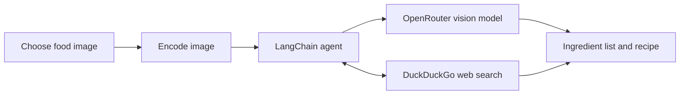

# Recipe AI Agent

Recipe AI Agent is a Python application that turns a food or ingredient photo into a recipe suggestion. It uses a LangChain agent with an OpenRouter-hosted vision model to identify ingredients and DuckDuckGo search to find recipe information online.

## What it does

- Lets you choose a local food image using a graphical picker or by pasting its path.
- Sends the image and a cooking request to the AI agent.
- Identifies and lists ingredients visible in the image.
- Searches the web for recipe ideas and includes sources when available.
- Provides a structured recipe with estimated servings, preparation/cooking time,
  ingredients, steps, and optional pantry staples.
- Prints the agent's response in the terminal.



## Requirements

- Python 3.13 or newer
- [uv](https://docs.astral.sh/uv/getting-started/installation/) for dependency management
- An [OpenRouter API key](https://openrouter.ai/keys)
- An internet connection for model requests and web search

## Clone and run

### 1. Clone the repository

```bash
git clone https://github.com/olalekan1/recipe-ai-agent.git
cd recipe-ai-agent
```

### 2. Configure your API key

Create a file named `.env` in the project root and add your OpenRouter key:

```dotenv
OPENROUTER_API_KEY=your_openrouter_api_key
```

Keep the key private. Do not commit `.env` or paste your key into source code.

### 3. Install dependencies

```bash
uv sync
```

### 4. Start the agent

```bash
uv run recipe-ai-agent
```

Choose whether to use the graphical file picker or paste/type an image path when prompted. The image must be a PNG, JPG, JPEG, or WebP file and no larger than **10 MB (10,000,000 bytes)**. Images are sent at their original size; the app does not resize them. Files over the limit are rejected before they are sent to the model.

**Privacy note:** The image is included in a request to the configured model provider. Only use images you are comfortable sending to that provider.

## Project layout

```text
recipe-ai-agent/
├── main.py                 # Compatibility entry point
├── pyproject.toml          # Project metadata and dependencies
├── uv.lock                 # Locked dependency versions
└── src/
    └── recipe_ai_agent/
        ├── cli.py          # Installed command entry point
        ├── model.py        # Model configuration
        ├── photo_handler.py
        ├── prompt.py
        ├── tools.py        # DuckDuckGo search tool
        └── logger_handler.py
```

## Troubleshooting

- **Missing API key:** Check that `.env` is in the project root and that its variable is named `OPENROUTER_API_KEY`.
- **Image not found or unsupported:** Confirm the path is correct and the image is PNG, JPG, JPEG, or WebP.
- **Image exceeds 10 MB:** Choose a smaller image file. The app does not resize images.
- **Search or model request fails:** Check your internet connection and confirm your OpenRouter key has access to the configured model.
